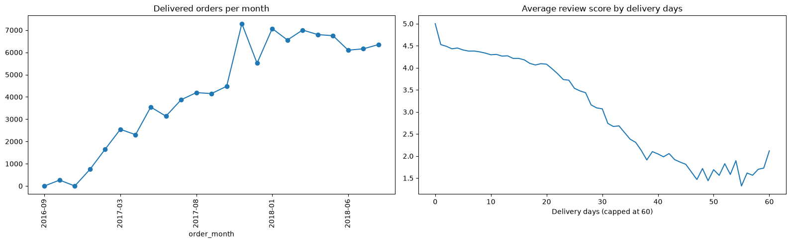
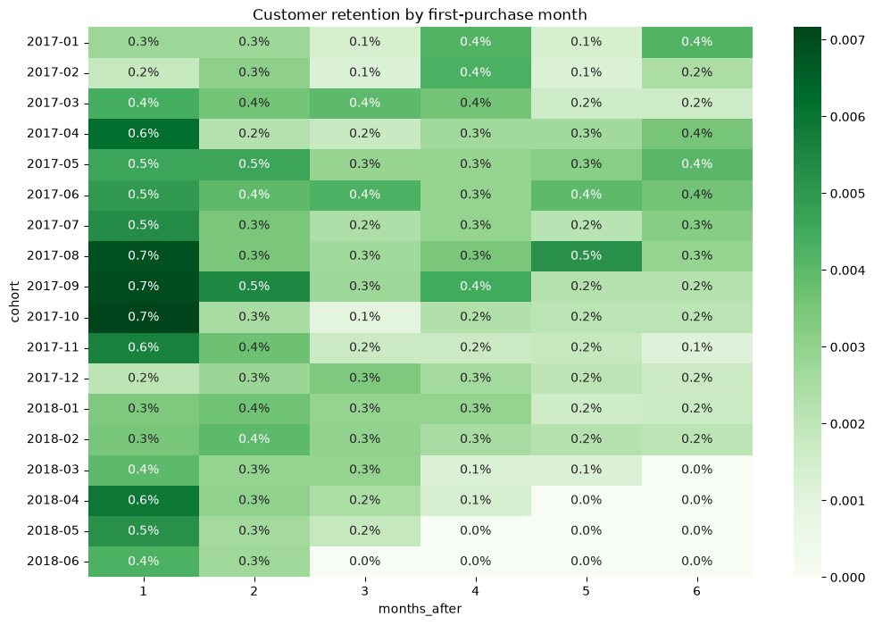
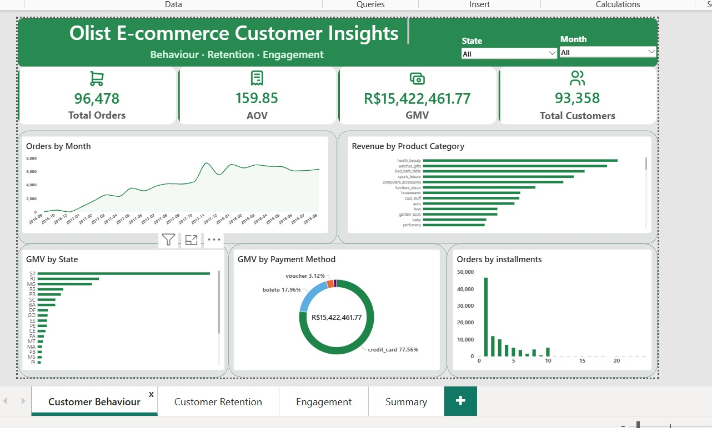
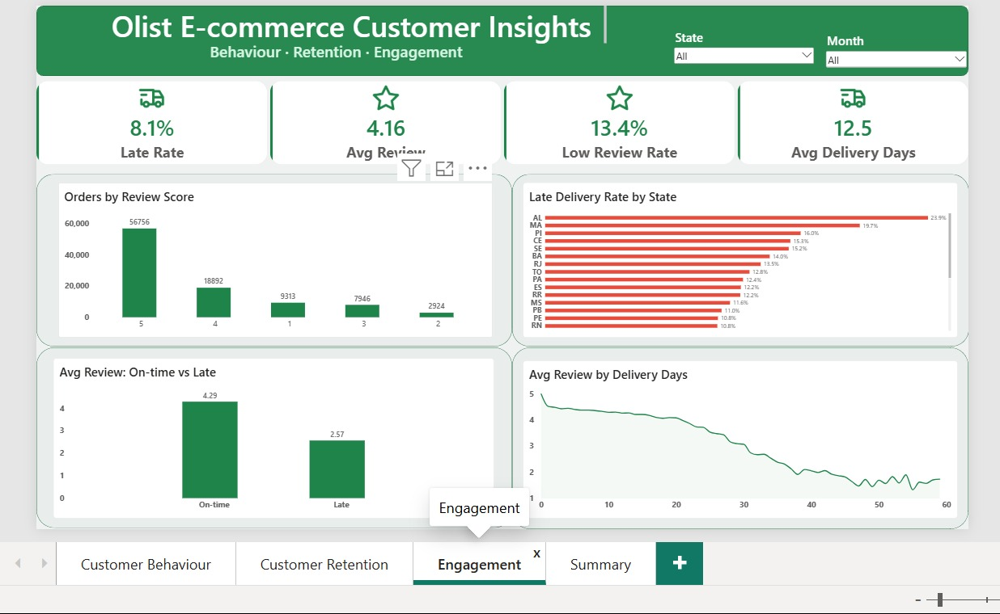
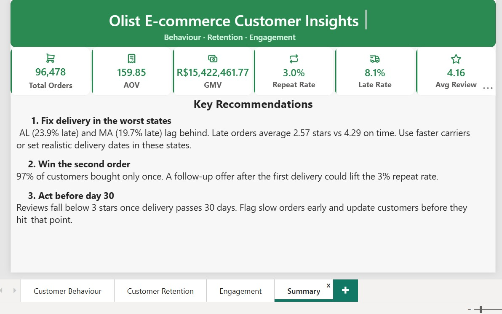

# Olist E-commerce Analysis: Behaviour, Retention, Engagement



## Business problem

Why do customers on a Brazilian online marketplace buy once and never come back?

I looked at that question through three lenses:

- **Behaviour**: what people buy, when they buy, and how they pay.
- **Retention**: how many customers come back for a second order.
- **Engagement**: how customers respond after an order. Olist has no clickstream data (no page views or sessions), so here engagement means **reviews and repeat activity**.

## Data & tools

**Data:** the [Olist Brazilian E-commerce public dataset](https://www.kaggle.com/datasets/olistbr/brazilian-ecommerce) from Kaggle, with orders from 2016 to 2018 across 8 related tables (orders, customers, order items, payments, reviews, products, sellers and a category translation table). I loaded it into MySQL and built one cleaned, single-source table, `orders_clean` (one row per order), so every tool reports the same numbers.

**Tools:**

- **MySQL**: import, cleaning, data quality checks, business questions
- **Python**: pandas, sqlalchemy, matplotlib / seaborn
- **Power BI**: 4-page dashboard (DAX measures, calculated columns, State and Month slicers)
- **Excel**: what-if profit model (scenario inputs, R$ formatting)

## What I did

### 1. SQL ([01_SQL](01_SQL))
- Imported the 8 tables into MySQL and fixed import issues (empty values turned into NULLs, a hidden BOM character in a column name).
- Checked row counts after every import, then looked for duplicates, missing values and impossible delivery dates.
- Answered business questions on monthly orders and revenue, top categories, payment methods, late deliveries by state, reviews for on-time vs late orders, repeat purchases, freight cost by category and top sellers.
- Built `orders_clean`, the single table that feeds Python, Power BI and Excel.

### 2. Python ([02_Python](02_Python))
- Connected to MySQL with sqlalchemy and pulled `orders_clean` into pandas.
- Charted monthly orders and the link between delivery time and review score (the image above).
- Built a monthly cohort retention analysis to see how many first-time buyers come back in later months (heatmap below).
- Charted review scores and repeat customers for the engagement view.
- The MySQL password is entered at run time with `getpass`, so no credentials are stored in the notebook.



### 3. Power BI ([03_PowerBI](03_PowerBI), file: [olist dashboard.pbix](olist%20dashboard.pbix))
A 4-page dashboard, **Olist E-commerce Customer Insights**, with State and Month slicers:

- **Customer Behaviour**: orders by month, revenue by category, GMV by state, payment method and instalments.
- **Customer Retention**: repeat vs one-time customers and the cohort view.
- **Engagement**: late rate, average review, low review rate (13.4%), orders by review score, late rate by state, reviews for on-time vs late orders, and review score by delivery days.
- **Summary**: 6 headline KPIs and 3 recommendations.

I added two calculated columns to make the visuals readable: `Review Stars` (whole-number review score) and `Delivery Status` (On-time / Late).





### 4. Excel ([04_Excel](04_Excel))
- Exported a 27-state summary from `orders_clean` (orders, customers, GMV, freight, AOV, late orders, average review) into the `State_Data` sheet and added a late-rate column.
- Built a `What_if` sheet with three inputs: late-order cut, repeat-rate uplift and an assumed margin.
- Outputs update live: late orders saved, extra GMV, new GMV, and profit before and after.
- Base case (2% repeat uplift): extra GMV of about R$298.6K, new GMV of about R$15.72M.
- The 20% margin is an assumption, not Olist data, and is labelled as such in the sheet.

## Key findings

Headline numbers (delivered orders):

| Metric | Value |
|---|---|
| Delivered orders | 96,478 |
| Customers | 93,358 |
| GMV | 15,422,461.77 |
| Average order value | 159.85 |
| Average review score | 4.16 |
| Orders delivered late | 8.1% |
| Average delivery time | 12.5 days |
| Repeat customer rate | 3.0% |

**Behaviour**
- Orders grew steadily and peaked in **November 2017 with 7,289 orders**.
- **Credit card** is the main payment method, at **77.56%** of GMV.

**Retention**
- **96.88%** of customers bought only once.
- The Python cohort analysis agrees: **97.0%** bought once, and **under 1%** of customers return in any later month.

**Engagement**
- Late deliveries hurt reviews badly: orders delivered on time average **4.29** stars, late ones only **2.57**.
- Orders delivered in around a week average about **4.5** stars. Once delivery passes **30 days**, the average falls **below 3**.
- Late delivery is worst in **AL (23.9%)** and **MA (19.7%)**.

**Takeaway:** customers are mostly happy (4.16 average rating), yet almost none come back. **This is a retention problem, not a quality problem.**

## Recommendations

1. **Fix late delivery in AL and MA first.** These states have the highest late rates, and late orders get far lower reviews.
2. **Re-engage first-time buyers after delivery.** With about 97% buying only once, a simple follow-up (thank-you message, review request, offer on a second order) targets the biggest gap.
3. **Set honest delivery-time promises.** Ratings drop as delivery time grows, so realistic estimates protect reviews and trust.

## Repo structure

```
olist-ecommerce-analysis/
├── 01_SQL/
│   └── 01_olist_sql_analysis.sql      # import, cleaning, DQ checks, business questions, orders_clean
├── 02_Python/
│   ├── 02_python_cohort_retention.ipynb  # MySQL -> pandas, charts, cohort retention
│   ├── behaviour_charts.png
│   ├── engagement_charts.png
│   └── retention_heatmap.png
├── 03_PowerBI/
│   └── page1-4 screenshots (.jpg)
├── olist dashboard.pbix               # 4-page Power BI dashboard
├── 04_Excel/                          # Excel what-if model (olist_what_if.xlsx)
└── README.md
```

## About me

I'm **Tajudeen Olugbenga Rabiu**, an accountant moving into e-commerce data analysis. My accounting background means I check the numbers before I report them, and I like turning data into decisions a business can act on.

- LinkedIn: [linkedin.com/in/tajudeen-rabiu-data](https://www.linkedin.com/in/tajudeen-rabiu-data)
- Portfolio: [teejay-data-io.github.io](https://teejay-data-io.github.io/)
